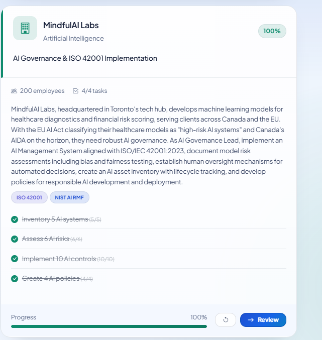
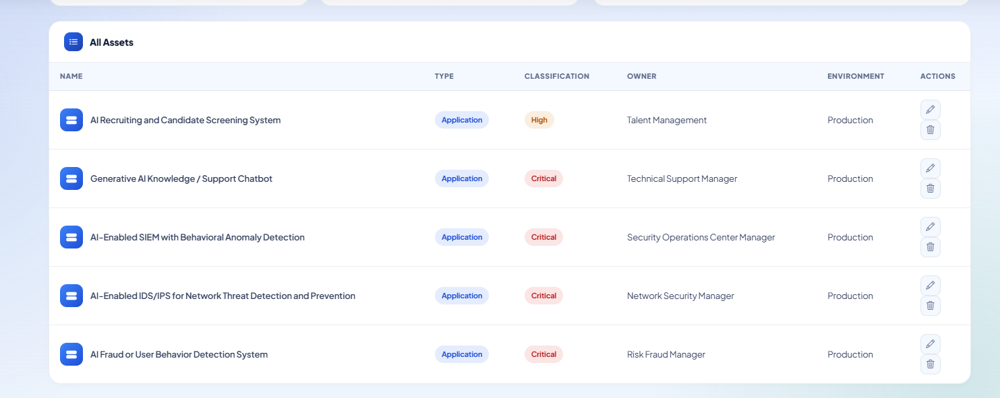
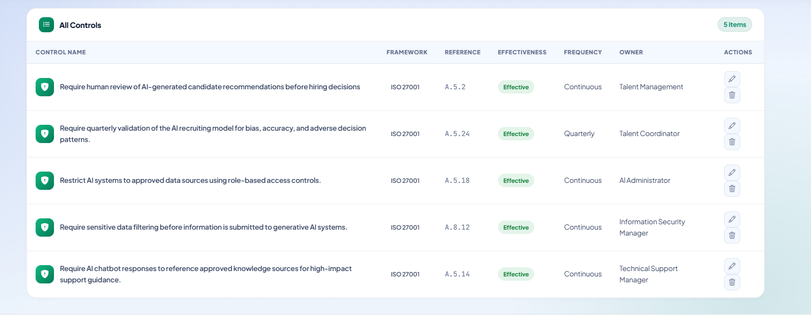
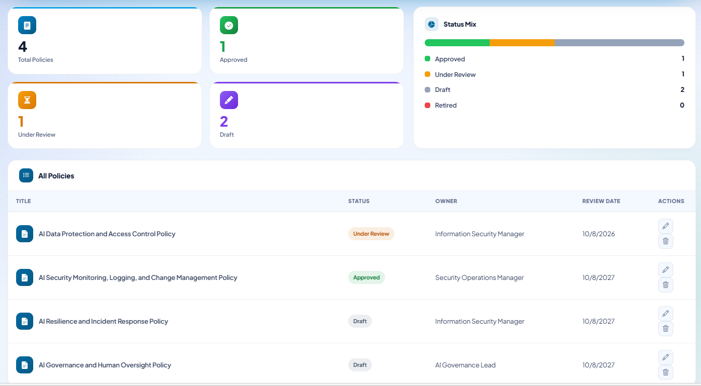

# AI Governance & ISO 42001 GRC Lab

A hands-on AI governance and GRC portfolio project built from the **MindfulAI Labs** practice scenario in the PurpleCop GRC Practice Lab.

The goal of this project was to move beyond theory and work through an end-to-end AI governance lifecycle: inventorying AI systems, assessing AI risks, designing controls, and creating governance policies aligned to an AI management system approach.

> **Note:** This repository documents an educational lab. The organization, systems, risks, controls, and policies shown here are practice artifacts and should be adapted before use in a real environment.

## Scenario

MindfulAI Labs is a fictional AI company with approximately 200 employees that develops machine-learning systems for healthcare diagnostics and financial risk scoring. The exercise required building governance artifacts that support an AI Management System aligned with **ISO/IEC 42001:2023**, while also applying security and risk-management concepts from **ISO/IEC 27001** and the **NIST AI Risk Management Framework (AI RMF)**.

The lab objectives were to:

- Inventory 5 AI systems.
- Assess 6 AI-related risks.
- Implement 10 AI controls.
- Create 4 AI governance policies.



## Why This Project Matters

AI governance is not only about writing policies. Organizations need a repeatable way to answer four practical questions:

1. **What AI systems are we using?**
2. **What can go wrong?**
3. **What controls reduce those risks?**
4. **What policies make those controls repeatable and accountable?**

This project demonstrates that workflow from an operational GRC perspective. It connects technical AI systems to business ownership, risk statements, control design, testing concepts, and policy governance.

## Project Deliverables

### 1. AI System Inventory

Five AI-enabled systems were documented with an owner, environment, classification, and business purpose.

| AI System | Type | Classification | Owner | Environment |
|---|---|---:|---|---|
| AI Recruiting and Candidate Screening System | Application | High | Talent Management | Production |
| Generative AI Knowledge / Support Chatbot | Application | Critical | Technical Support Manager | Production |
| AI-Enabled SIEM with Behavioral Anomaly Detection | Application | Critical | Security Operations Center Manager | Production |
| AI-Enabled IDS/IPS for Network Threat Detection and Prevention | Application | Critical | Network Security Manager | Production |
| AI Fraud or User Behavior Detection System | Application | Critical | Risk/Fraud Manager | Production |



### 2. AI Risk Register

Risk statements were written using the structure:

> **[Threat] + [Vulnerability] + [Impact] + [Asset]**

Examples explored in the lab included:

- AI hallucination combined with overreliance on automated recruiting scores, resulting in qualified candidates being incorrectly rejected.
- A broken chatbot integration combined with no failover capability, causing support-ticket backlogs and customer-service delays.
- SIEM model misclassification caused by missing endpoint telemetry, potentially leading to incorrect threat remediation or missed attacks.
- AI-enabled IDS/IPS false positives caused by poor model tuning, blocking legitimate traffic and affecting application availability.
- Fraud-detection model errors caused by incomplete or biased data, resulting in legitimate activity being incorrectly flagged.
- Generative AI data exposure caused by weak access controls or improper data permissions.

The risk-assessment process considered **likelihood, impact, ownership, status, business impact, and decision rationale** rather than just listing generic threats.

### 3. AI Controls

Ten controls were designed to be **specific, measurable, and testable**.

Representative controls included:

- Human review of AI-generated candidate recommendations before hiring decisions.
- Quarterly validation of recruiting models for bias, accuracy, and adverse decision patterns.
- Role-based access restrictions limiting AI systems to approved data sources.
- Continuous sensitive-data filtering before information is submitted to generative AI systems.
- Approved-source requirements for high-impact AI chatbot guidance.
- Human-support failover procedures for chatbot outages.
- Continuous monitoring of AI-enabled SIEM/IDS models for false positives and false negatives.
- Formal change management for AI models, prompts, configurations, and integrations.
- Centralized logging of AI prompts, outputs, administrative changes, and security events.
- Annual AI-specific incident-response testing.



## 4. AI Governance Policies

The controls were grouped under four broader policies instead of creating one policy for every control:

1. **AI Governance and Human Oversight Policy**
2. **AI Data Protection and Access Control Policy**
3. **AI Security Monitoring, Logging, and Change Management Policy**
4. **AI Resilience and Incident Response Policy**

This mirrors how governance programs are typically structured: high-level policies establish requirements, while individual controls define how those requirements are implemented and tested.



---

# Step-by-Step: How to Recreate the Project

## Step 1 — Define the AI Governance Scope

Start by identifying the organization, the business processes in scope, and the AI-related regulatory or contractual drivers.

For this lab, the scope included:

- AI systems used in production.
- AI-assisted hiring.
- Generative AI support tools.
- AI-enabled security monitoring.
- AI-enabled fraud detection.
- AI governance, security, resilience, and human oversight.

Before documenting risks, define what is considered an **AI system**. Automation alone is not necessarily AI. For example, a traditional rule-based IDS may be automated without using machine learning. An AI-enabled IDS/IPS may use machine learning, behavioral analytics, or anomaly detection to classify activity.

## Step 2 — Build the AI Asset Inventory

For each AI system, document:

- **Name** — clear system name.
- **Type** — application, platform, model, service, etc.
- **Classification** — Low, Medium, High, or Critical based on business impact and data sensitivity.
- **Owner** — the business or technical role accountable for the system.
- **Environment** — Development, Test, or Production.
- **Description** — what the AI system does, who uses it, and what information it processes.

Example:

```text
Name: AI Recruiting and Candidate Screening System
Type: Application
Classification: High
Owner: Talent Management
Environment: Production
Description: AI-enabled recruiting system used to record and analyze candidate interview responses and provide screening or evaluation outputs for hiring decisions.
```

## Step 3 — Identify AI Risks

For each AI system, identify a realistic failure mode or threat and connect it to a weakness and business impact.

Use this structure:

```text
[Threat] due to/exploits [Vulnerability], causing [Impact] to [Asset]
```

Ask four questions:

1. **Threat:** What can go wrong, or who/what could cause harm?
2. **Vulnerability:** What weakness allows it to happen?
3. **Impact:** What is the actual business or security consequence?
4. **Asset:** What system, data set, service, or process is affected?

Then assign:

- Category
- Status
- Likelihood (1–5)
- Impact (1–5)
- Risk owner
- Description
- Decision rationale

Avoid vague risks such as “AI failure” or “data breach.” The goal is to make the scenario actionable.

## Step 4 — Score and Prioritize Risks

Use a simple likelihood × impact model if that is what your organization uses.

```text
Risk Score = Likelihood × Impact
```

The most important part is not the exact number—it is the **rationale** behind the number.

For example:

```text
Likelihood: 4 – Likely
Impact: 4 – Major
Risk Score: 16 – High

Rationale: The support team receives hundreds of requests each day and relies on the AI chatbot. A prolonged outage could create a significant ticket backlog, delay customer support, disrupt business continuity, and affect a revenue-generating service.
```

## Step 5 — Design Controls

A good control should be:

- **Specific** — clearly states what must happen.
- **Measurable** — has evidence that can be reviewed.
- **Testable** — an auditor or assessor can determine whether it is operating.

Weak control:

```text
Use AI securely.
```

Stronger control:

```text
Require Talent Management to review every AI-assisted candidate recommendation before a final hiring decision is made.
```

For each control, document:

- Control name
- Framework/reference
- Effectiveness rating
- Frequency
- Owner
- Description
- Decision rationale

When possible, describe how the control would be tested.

## Step 6 — Apply Human Oversight

For high-impact AI decisions, define where human review is required.

Example recruiting workflow:

1. AI conducts or assists with an interview.
2. The interview is recorded or otherwise documented.
3. Talent Management reviews the AI output.
4. The reviewer identifies inaccurate or inappropriate conclusions.
5. Material errors trigger a follow-up interview or reassessment.
6. A final hiring decision is made only after human review.

This turns “human in the loop” from a slogan into a testable control.

## Step 7 — Protect Data Used by AI

Apply least privilege and data-minimization principles.

Controls can include:

- Role-based access control (RBAC).
- Approved data-source lists.
- Data-loss prevention (DLP).
- Sensitive-data redaction or masking.
- Access reviews.
- Separation of development/test data from production data.

The goal is to prevent AI systems from having unrestricted access to information they do not need.

## Step 8 — Monitor AI Security and Performance

AI-enabled security tools should also be governed.

Monitor for:

- False positives.
- False negatives.
- Missing telemetry.
- Model drift.
- Detection degradation.
- Poor tuning.
- Unapproved model/configuration changes.

Maintain logs that can support investigations and control testing.

## Step 9 — Establish Resilience and Incident Response

AI-supported business processes should have fallback procedures.

Examples:

- Route chatbot requests to human support if the AI service fails.
- Maintain rollback plans for model changes.
- Include AI incidents in incident-response tabletop exercises.
- Test scenarios such as data leakage, model failure, prompt injection, hallucinated high-impact output, and compromised integrations.

## Step 10 — Create Governance Policies

Group related controls under broader policies.

A practical four-policy model is:

```text
1. AI Governance and Human Oversight Policy
2. AI Data Protection and Access Control Policy
3. AI Security Monitoring, Logging, and Change Management Policy
4. AI Resilience and Incident Response Policy
```

Each policy should have:

- Owner
- Status
- Review date
- Scope
- Policy requirements
- Related controls
- Exceptions process
- Review cadence

## Step 11 — Review the Program as a System

The final step is to verify traceability:

```text
AI Asset
   ↓
Risk
   ↓
Control
   ↓
Policy
   ↓
Evidence / Testing
```

A mature AI governance program should be able to show that every significant AI risk has accountable ownership and one or more controls, and that those controls are backed by policy and evidence.

---

# Skills Demonstrated

- AI governance
- AI risk assessment
- GRC program design
- AI asset inventory management
- Risk-register development
- Control design and testing concepts
- Human oversight design
- AI security monitoring
- Data protection and RBAC
- AI incident response and resilience
- ISO/IEC 42001 concepts
- ISO/IEC 27001 control mapping
- NIST AI RMF concepts

## Repository Structure

```text
ai-governance-grc-lab/
├── README.md
├── docs/
│   ├── ai-assets.md
│   ├── risks.md
│   ├── controls.md
│   └── policies.md
└── screenshots/
    ├── project-completion.png
    ├── ai-assets-list.png
    ├── controls-list.png
    ├── policy-library-completed.png
    └── ...
```

## Screenshots

The `screenshots/` directory contains supporting evidence from the completed practice lab. Screenshots are included to show the workflow and final outputs; the underlying PurpleCop application is not part of this repository.

## Disclaimer

This repository is a portfolio/learning project and does not represent legal, regulatory, audit, or certification advice. ISO control mappings shown in the lab are illustrative and should be validated against the organization’s actual scope, risk methodology, and licensed standard documentation before production use.
